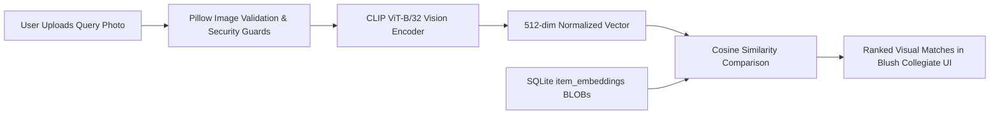

# College Lost & Found Management Website

A modern, full-stack campus **Lost & Found Management System**, built using **Python Flask**, **SQLite**, **OpenAI CLIP (Multimodal Neural Search)**, **Tailwind CSS**, and **pytest**.

This project features both a responsive Web User Interface and RESTful API endpoints structured for academic clarity, ease of explanation during technical vivas/presentations, and adherence to software engineering standards.

---

## 🔍 OpenAI CLIP Visual Similarity Search

CampusLandF features an end-to-end visual similarity search engine powered by **OpenAI CLIP (Contrastive Language–Image Pre-training, `ViT-B/32`)**.

### How Image Similarity Differs from Keyword Search
- **Keyword Search**: Relies on literal textual substring matching across titles, descriptions, and locations (e.g. searching "Sony" will miss reports titled "Black wireless earbuds").
- **CLIP Visual Similarity**: Maps uploaded photographs into a dense 512-dimensional semantic embedding space. By calculating the **cosine similarity** between normalized vector representations, the system finds visually and semantically similar objects even when reported with completely different terminology or languages.



### Architecture & Key Features:
1. **Official OpenAI CLIP Implementation**: Uses `ViT-B/32` with PyTorch visual transformers.
2. **Device Detection & Hardware Acceleration**:
   - **Apple Silicon (MPS)**: Automatically detects Metal Performance Shaders on macOS arm64 for high-speed GPU tensor ops.
   - **NVIDIA CUDA**: Utilizes CUDA cores when running on compatible Linux/Windows servers.
   - **CPU Fallback**: Gracefully operates on standard x86_64 or arm64 CPUs if accelerators are unavailable.
3. **Lazy Singleton Architecture**:
   - Model weights (~338 MB) are cached locally in `~/.cache/clip` upon first run.
   - Loaded lazily into memory only when visual search or embedding operations are called.
   - Reused across requests via a thread-safe singleton (`CLIPService.get_instance()`), avoiding expensive reloads.
4. **SQLite Embedding Storage (`item_embeddings`)**:
   - Dedicated table storing serialized 512-dimensional float32 arrays as SQLite `BLOB`s (2,048 bytes per record).
   - Foreign key constraint with `ON DELETE CASCADE` ensures automatic cleanup when items are removed.
   - Recomputes embeddings whenever an item's photo is updated or replaced.
5. **Backfill & On-Demand Inference**:
   - Items with images can be backfilled in bulk via CLI command: `flask --app app backfill-embeddings`.
   - On-demand inference fallback computes embeddings automatically if an image is missing its vector index.
6. **Upload Validation & Security**:
   - Pillow-level integrity verification prevents malicious files, invalid headers, and decompression bomb attacks (`Image.MAX_IMAGE_PIXELS = 25_000_000`).
   - File size limits (5 MB per photo) strictly enforced.
   - Secure filename sanitization via Werkzeug.
7. **Important Limitations & Integrity Policy**:
   - **Visual Similarity is NOT Identity**: Two objects with high visual similarity (e.g. identical white hydro flasks or black headphones) may look alike but belong to different people.
   - **No Automated Claims**: Similarity scores are presented as similarity indicators (e.g. "86% Visual Match") with clear user tooltips. The system **never** automatically approves claims or transfers ownership based on machine learning scores alone. Rightful owners must still complete the custodial verification process.

---

## 🎨 Frontend UI/UX Design System (Blush Collegiate)

The user interface follows the **Blush Collegiate** design.
- **Color Palette**:
  - Primary: `#974259` (Deep Berry / Rose)
  - Secondary Container: `#f8dce2` (Blush Accent)
  - Tertiary / Success: `#35675a` (Sage / Verified Emerald)
  - Background: `#fbf8ff` (Warm Ivory Canvas)
  - Surfaces: `#ffffff` & `#f5f2f9`
- **Typography**: Plus Jakarta Sans (`headline-xl`, `headline-lg`, `body-md`, `label-sm`)
- **Icons**: Google Material Symbols Outlined
- **Framework**: Tailwind CSS (via CDN with custom theme extensions)

### Web Pages:
- **`GET /` (Homepage)**: Hero banner, campus registry live stats, quick action center, recently reported live feed, 4-step safe handover protocol, campus custody desks.
- **`GET /browse` or `GET /board` (Campus Board)**: Real-time search, segmented tabs (`All`, `Lost`, `Found`), category filters, sorting, dynamic item cards, full details modal, and interactive "Claim Item" workflow.
- **`GET /report` (Report Item)**: Lost/Found toggle, category dropdown, campus location & date picker, description character counter, drag-and-drop photo upload with instant preview.
- **`GET /claims` (My Claims)**: Track submitted ownership claims, view verification notes, and see status badges (`Pending`, `Approved`, `Rejected`).
- **`GET /admin` (Admin Control Panel)**: Real-time system stats, pending ownership claims review (one-click Approve / Reject), and item report status management (`open`, `claimed`, `returned`, `resolved`).

---

## 📁 Project Architecture & Directory Structure

```text
college-lost-and-found/
├── .env.example          # Template for environment configuration & secrets
├── .env                  # Local environment file (git-ignored)
├── .gitignore            # Excludes databases, virtual environments, and secrets
├── requirements.txt      # Minimal project dependencies (Flask, pytest, python-dotenv)
├── README.md             # Project documentation and API specifications
├── app.py                # Application factory (create_app), error handlers, entry point
├── database.py           # SQLite connection lifecycle (get_db, close_db, init_db)
├── models.py             # DDL schemas, domain constants, and serialization helpers
├── routes/               # Modular Flask Blueprints (API & Web endpoints)
│   ├── __init__.py       # Blueprint registry
│   ├── admin_routes.py   # Admin management endpoints (/api/admin/users, /api/admin/stats, review)
│   ├── auth_routes.py    # Authentication (register, login, logout, me, notifications) & RBAC
│   ├── claim_routes.py   # Ownership claims endpoints (/api/items/<id>/claims, /api/claims/my)
│   ├── health.py         # Health check endpoint (/api/health) & DB ping
│   ├── item_routes.py    # Lost & found item reporting, listing, filters, and image serving
│   └── web_routes.py     # Frontend web routes (/, /browse, /report, /claims, /admin)
├── services/             # Business logic layer
│   ├── __init__.py
│   ├── auth_service.py   # Password hashing (Werkzeug), user creation, authentication
│   ├── claim_service.py  # Claim submission, admin review, and item lifecycle transitions
│   ├── clip_service.py   # OpenAI CLIP singleton model loader, image validation, embeddings
│   ├── item_service.py   # Validation, search, CLIP image similarity, and SQLite embedding ops
│   └── seed_service.py   # Auto-seeds realistic demo items matching the Stitch UI design
├── templates/            # Jinja2 HTML Templates (Blush Collegiate UI/UX)
│   ├── base.html         # Base layout with navbar, auth modal, notifications & footer
│   ├── index.html        # Homepage with hero, metrics, live feed, custody desks
│   ├── board.html        # Interactive Lost & Found catalog board with CLIP photo search & claim modal
│   ├── report.html       # Report Lost/Found form with drag-and-drop image upload
│   ├── claims.html       # Student claims verification & tracking page
│   └── admin.html        # Administrator moderation & claim approval panel
├── tests/                # Automated pytest suite (81 test cases)
│   ├── __init__.py
│   ├── conftest.py       # Isolated test client and temporary DB fixtures
│   ├── test_audit.py     # Edge cases, date validation, 404s, case-insensitivity, stale sessions
│   ├── test_auth.py      # Registration, login, duplicate check, and RBAC tests
│   ├── test_claims.py    # Claim submission, approval/rejection cascades, status transitions
│   ├── test_clip.py      # CLIP service, embeddings, normalization, ranking, image search API & CLI
│   ├── test_database.py  # Schema initialization, tables, foreign keys & cascade tests
│   ├── test_errors.py    # Custom JSON error handler tests (404, 405)
│   ├── test_health.py    # Health check endpoint tests
│   ├── test_items.py     # Reporting, search, filters, image uploads, edit/delete auth
│   ├── test_services.py  # Password hashing, validation, & item tests
│   └── test_web.py       # Frontend web page rendering and template verification tests
├── pytest.ini            # Pytest configuration and markers
└── uploads/              # Storage directory for uploaded item photos (.gitkeep)
```

---

## 🛡️ Security Best Practices

1. **No Plain-Text Passwords**: Passwords are cryptographically hashed using Werkzeug (`generate_password_hash` with secure salting). Plain text passwords are never stored in the database.
2. **Data Sanitization**: Internal model serializers (`user_to_dict`) explicitly exclude sensitive fields like `password_hash` from API payloads.
3. **Session Security & Fixation Protection**:
   - `SESSION_COOKIE_HTTPONLY = True`: Blocks JavaScript from reading the cookie, mitigating XSS attacks.
   - `SESSION_COOKIE_SAMESITE = 'Lax'`: Mitigates Cross-Site Request Forgery (CSRF).
   - `session.clear()` is called on login to prevent session fixation attacks.
4. **Role-Based Access Control (RBAC)**: Custom decorators `@login_required` (HTTP 401) and `@admin_required` (HTTP 403) protect sensitive resources.
5. **No Secrets in Source Control**: Secrets and environment configurations are loaded from `.env` (via `.env.example`). `.env` and SQLite database files (`*.db`) are ignored in `.gitignore`.
6. **SQL Injection Prevention**: All queries use parameterized placeholders (`?`), preventing SQL injection attacks.
7. **Upload Protection**: File upload size limits are enforced via `MAX_CONTENT_LENGTH` (16MB default).

---

## 🗄️ Database Design (SQLite)

- **`users`**:
  - `id` (INTEGER PRIMARY KEY AUTOINCREMENT)
  - `name` (TEXT NOT NULL)
  - `email` (TEXT UNIQUE NOT NULL)
  - `password_hash` (TEXT NOT NULL)
  - `role` (TEXT NOT NULL CHECK(role IN ('student', 'faculty', 'staff', 'admin')))
  - `phone` (TEXT)
  - `created_at` (TIMESTAMP DEFAULT CURRENT_TIMESTAMP)

- **`items`**:
  - `id` (INTEGER PRIMARY KEY AUTOINCREMENT)
  - `title` (TEXT NOT NULL)
  - `description` (TEXT NOT NULL)
  - `category` (TEXT NOT NULL)
  - `type` (TEXT NOT NULL CHECK(type IN ('lost', 'found')))
  - `location` (TEXT NOT NULL)
  - `date_event` (DATE NOT NULL)
  - `status` (TEXT NOT NULL CHECK(status IN ('open', 'claimed', 'resolved', 'returned')))
  - `image_filename` (TEXT)
  - `user_id` (INTEGER NOT NULL REFERENCES users(id) ON DELETE CASCADE)
  - `contact_email` (TEXT)
  - `contact_phone` (TEXT)
  - `created_at` (TIMESTAMP DEFAULT CURRENT_TIMESTAMP)

- **`claims`**:
  - `id` (INTEGER PRIMARY KEY AUTOINCREMENT)
  - `item_id` (INTEGER NOT NULL REFERENCES items(id) ON DELETE CASCADE)
  - `claimant_id` (INTEGER NOT NULL REFERENCES users(id) ON DELETE CASCADE)
  - `proof_details` (TEXT NOT NULL)
  - `status` (TEXT NOT NULL CHECK(status IN ('pending', 'approved', 'rejected')))
  - `admin_notes` (TEXT)
  - `created_at` (TIMESTAMP DEFAULT CURRENT_TIMESTAMP)

- **`notifications`**:
  - `id` (INTEGER PRIMARY KEY AUTOINCREMENT)
  - `user_id` (INTEGER NOT NULL REFERENCES users(id) ON DELETE CASCADE)
  - `title` (TEXT NOT NULL)
  - `message` (TEXT NOT NULL)
  - `is_read` (INTEGER NOT NULL DEFAULT 0 CHECK(is_read IN (0, 1)))
  - `created_at` (TIMESTAMP DEFAULT CURRENT_TIMESTAMP)

---

## 🔌 API Endpoints Specification

### 1. Health & Discovery
- `GET /api/health`: Health status & SQLite connectivity test.
- `GET /`: API metadata and registered endpoints directory.

### 2. Authentication (`/api/auth`)
- `POST /api/auth/register`: Register new user.
  - Body: `{"name": "...", "email": "...", "password": "...", "role": "student|faculty|staff|admin", "phone": "..."}`
  - Status codes: `201 Created`, `400 Bad Request` (validation error), `409 Conflict` (duplicate email).
- `POST /api/auth/login`: Authenticate and start session.
  - Body: `{"email": "...", "password": "..."}`
  - Status codes: `200 OK`, `400 Bad Request`, `401 Unauthorized`.
- `POST /api/auth/logout`: Invalidate and clear current session.
  - Status codes: `200 OK`.
- `GET /api/auth/me`: Get profile of authenticated user.
  - Protected: `@login_required`.
  - Status codes: `200 OK`, `401 Unauthorized`.
- `GET /api/auth/notifications`: List notifications for current user.
  - Protected: `@login_required`.
  - Status codes: `200 OK`, `401 Unauthorized`.
- `PATCH /api/auth/notifications/<id>/read`: Mark a notification as read.
  - Protected: `@login_required`.
  - Status codes: `200 OK`, `401 Unauthorized`, `404 Not Found`.

### 3. Admin Management & Claim Review (`/api/admin`)
- `GET /api/admin/users`: List all registered accounts (passwords sanitized).
  - Protected: `@admin_required`.
  - Status codes: `200 OK`, `401 Unauthorized`, `403 Forbidden`.
- `GET /api/admin/stats`: Total counts of users, items, claims, and notifications.
  - Protected: `@admin_required`.
  - Status codes: `200 OK`, `401 Unauthorized`, `403 Forbidden`.
- `GET /api/admin/reports`: List all submitted reports with optional filters.
  - Protected: `@admin_required`.
  - Status codes: `200 OK`, `401 Unauthorized`, `403 Forbidden`.
- `GET /api/admin/claims`: List all ownership claims across items.
  - Protected: `@admin_required`.
  - Query parameters: `status=pending|approved|rejected`, `item_id`.
  - Status codes: `200 OK`, `401 Unauthorized`, `403 Forbidden`.
- `POST /api/admin/claims/<id>/approve`: Approve a pending ownership claim.
  - Protected: `@admin_required`.
  - Effect: Transitions claim to `approved`, item status to `claimed`, auto-rejects other pending claims, notifies claimant.
  - Status codes: `200 OK`, `400 Bad Request` (invalid transition), `401 Unauthorized`, `403 Forbidden`, `404 Not Found`.
- `POST /api/admin/claims/<id>/reject`: Reject a pending ownership claim.
  - Protected: `@admin_required`.
  - Body: `{"admin_notes": "..."}` (optional).
  - Effect: Transitions claim to `rejected`, notifies claimant.
  - Status codes: `200 OK`, `400 Bad Request`, `401 Unauthorized`, `403 Forbidden`, `404 Not Found`.
- `PUT /api/admin/claims/<id>` / `PATCH /api/admin/claims/<id>`: Unified review endpoint.
  - Protected: `@admin_required`.
  - Body: `{"status": "approved|rejected", "admin_notes": "..."}`.
  - Status codes: `200 OK`, `400 Bad Request`, `401 Unauthorized`, `403 Forbidden`, `404 Not Found`.
- `PUT /api/admin/items/<id>/status` / `PATCH /api/admin/items/<id>/status`: Update item lifecycle status.
  - Protected: `@admin_required`.
  - Body: `{"status": "returned|resolved|open|claimed", "admin_notes": "..."}`.
  - Enforces invalid transition prevention: closed/returned/resolved items cannot be reverted to `open`.
  - Status codes: `200 OK`, `400 Bad Request`, `401 Unauthorized`, `403 Forbidden`, `404 Not Found`.

### 4. Items & Uploads (`/api/items`)
- `POST /api/items`: Report a lost or found item.
  - Protected: `@login_required`.
  - Content-Type: `multipart/form-data` (with image) or `application/json` (text-only).
  - Fields: `title`, `description`, `category`, `type` (`lost`|`found`), `location`, `date_event`, `image` (file, optional), `contact_email`, `contact_phone`.
  - Status codes: `201 Created`, `400 Bad Request` (validation / file-type / file-size failure), `401 Unauthorized`.
- `GET /api/items`: Search and filter items.
  - Public.
  - Query parameters:
    - `q` or `search`: Keyword search across title, description, and location.
    - `type`: Filter by item type (`lost` or `found`).
    - `category`: Filter by category (e.g., `Electronics`, `Keys`, `Clothing`).
    - `location`: Substring filter on location.
    - `status`: Filter by status (`open`, `claimed`, `returned`, `resolved`).
  - Status codes: `200 OK`.
- `GET /api/items/<id>`: Retrieve specific item details.
  - Public.
  - Status codes: `200 OK`, `404 Not Found`.
- `PUT /api/items/<id>` / `PATCH /api/items/<id>`: Update an existing report.
  - Protected: `@login_required` (only the report owner or an admin can edit).
  - Status codes: `200 OK`, `400 Bad Request`, `401 Unauthorized`, `403 Forbidden`, `404 Not Found`.
- `DELETE /api/items/<id>`: Delete an item report.
  - Protected: `@login_required` (only the report owner or an admin can delete).
  - Status codes: `200 OK`, `401 Unauthorized`, `403 Forbidden`, `404 Not Found`.
- `GET /uploads/<filename>`: Fetch uploaded item images.
  - Public.
  - Status codes: `200 OK`, `404 Not Found`.

### 5. OpenAI CLIP Image Similarity Search (`/api/items/search/image`)
- `POST /api/items/search/image` (alias: `/api/items/search-by-image`):
  - Upload a photograph to find visually similar lost or found items.
  - Content-Type: `multipart/form-data`.
  - Body:
    - `image`: Image file (JPEG, PNG, WebP; max 5MB).
    - `type` (optional): Filter to `lost` or `found`.
    - `category` (optional): Filter by category (e.g. `Electronics`, `Bags & Wallets`).
    - `location` (optional): Substring location filter.
    - `status` (optional): Filter by status (`open`, `claimed`, etc.).
    - `top_k` (optional, default `20`): Maximum results to return.
    - `threshold` (optional, default `0.0`): Minimum cosine similarity cutoff.
  - Returns: Ranked items list with `similarity_score` ([-1.0, 1.0]), `similarity_percent` (0-100%), and model metadata.
  - Status codes: `200 OK`, `400 Bad Request` (invalid image / missing file), `503 Service Unavailable` (model loading failure).
- `GET /api/items/similarity/info`:
  - Public endpoint returning CLIP runtime status, active compute device (`mps`, `cuda`, or `cpu`), model version, total embeddings count, and database coverage percentage.
  - Status codes: `200 OK`.

### 6. Ownership Claims (`/api/items/<id>/claims` & `/api/claims`)
- `POST /api/items/<id>/claims`: Submit an ownership claim for a found item with proof description.
  - Protected: `@login_required`.
  - Body: `{"proof_details": "..."}` (minimum 10 characters).
  - Rules: Only found items can be claimed; users cannot claim their own reports; duplicate pending claims are prevented.
  - Status codes: `201 Created`, `400 Bad Request`, `401 Unauthorized`, `404 Not Found`.
- `GET /api/claims/my`: Retrieve all claims submitted by the current user.
  - Protected: `@login_required`.
  - Status codes: `200 OK`, `401 Unauthorized`.
- `GET /api/items/<id>/claims`: Retrieve claims for a specific item (reporter or admin only).
  - Protected: `@login_required`.
  - Status codes: `200 OK`, `401 Unauthorized`, `403 Forbidden`, `404 Not Found`.

---

## 🚀 Local Setup & Installation

### 1. Navigate to the project directory
```bash
cd college-lost-and-found
```

### 2. Create and activate a Python virtual environment (Recommended)
```bash
python3 -m venv venv
source venv/bin/activate    # On Windows: venv\Scripts\activate
```

### 3. Install dependencies
```bash
pip install -r requirements.txt
```

> **Note on CLIP Model Weights**:
> The official OpenAI CLIP `ViT-B/32` model (~338 MB) is automatically downloaded on first use and cached in `~/.cache/clip`. Subsequent runs load directly from the local cache without downloading again.

### 4. Create your local environment file
```bash
cp .env.example .env
```

### 5. Initialize the SQLite database & Backfill Embeddings (Optional)
The database auto-initializes upon first start, but you can also manually initialize or reset it anytime using the CLI:
```bash
# Initialize SQLite database
flask --app app init-db

# Or drop existing tables and recreate cleanly from scratch:
flask --app app init-db --reset

# Backfill CLIP image embeddings for all items with photographs:
flask --app app backfill-embeddings

# Force re-computation of all embeddings:
flask --app app backfill-embeddings --force
```

---

## 🏃 Running the Application

Start the local development server:
```bash
python3 app.py
```
*(Default URL: `http://127.0.0.1:5001`. Port 5001 avoids macOS AirPlay receiver conflicts on port 5000).*

Open `http://127.0.0.1:5001/` in your web browser to explore the full Stitch UI/UX experience!

### 🔑 Pre-Seeded Demo Accounts:
Upon first launch, realistic campus sample items and two demo accounts are automatically prepared:
- **Student User**: `student@campus.edu` | Password: `StudentPass123`
- **Administrator**: `admin@campus.edu` | Password: `AdminPass123`
*(You can also use the "Quick Demo" buttons inside the Sign In modal to log in with 1 click).*

---

## 🧪 Running Automated Tests

Run the full 81-test pytest suite:
```bash
pytest -v
```

Tests cover:
- Table creation, SQLite foreign key constraints, and cascade deletes
- CLIP service initialization, thread-safe singleton, and hardware device detection
- Image validation, format checks, and decompression bomb prevention
- L2 embedding normalization and mathematical cosine similarity invariants
- SQLite embedding persistence, invalidation, and cascade deletion
- Visual similarity search ranking, multi-parameter filters, and thresholding
- Missing image file handling and graceful degradation
- Successful user registration, login, session cookies, and logout
- Duplicate email registration conflict (409)
- Incorrect password & non-existent user handling (401)
- Role-based access control (Student vs Admin)
- Health check & custom JSON error handlers (400, 404, 405, 500)
- Frontend Web Route rendering (`/`, `/browse`, `/report`, `/claims`, `/admin`)
- Live smoke test verifying end-to-end embedding inference with official CLIP model

---

## 🔧 Troubleshooting & FAQ

1. **How do I know which device CLIP is running on?**
   Query the diagnostic endpoint:
   ```bash
   curl http://127.0.0.1:5001/api/items/similarity/info
   ```
   On Apple Silicon Macs, `device` will report `"mps"`. On NVIDIA servers, `"cuda"`. On standard machines, `"cpu"`.

2. **Model Download Times Out or Running Offline?**
   If working offline or behind a proxy, pre-download `ViT-B-32.pt` and place it in `~/.cache/clip/ViT-B-32.pt`. If the model is temporarily unavailable, the application continues to operate cleanly in keyword-search mode and returns HTTP 503 on visual search requests without crashing.

3. **Port 5000 in use on macOS?**
   macOS uses port 5000 for AirPlay Receiver. CampusLandF defaults to port **5001** via `.env` (`PORT=5001`). If you need another port, simply update `.env`.
